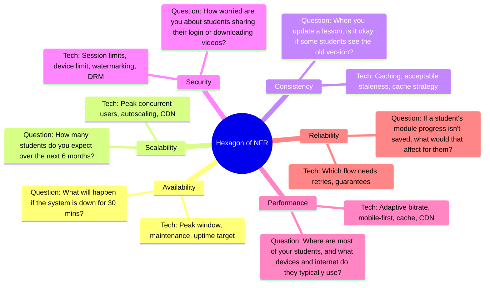
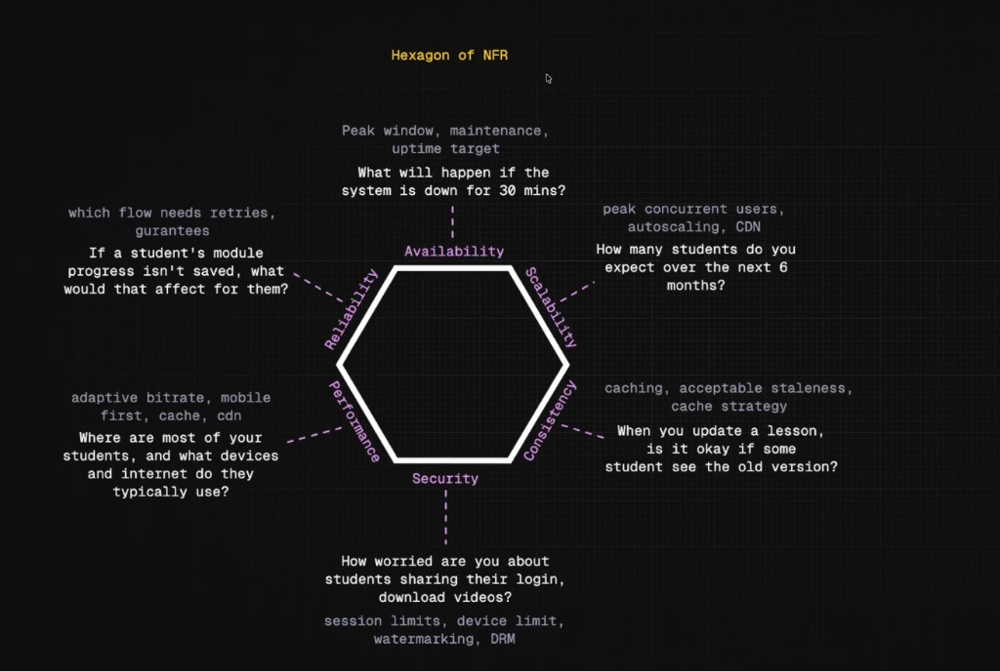

# Gathering Requirements

> **Quote (*The Mythical Man-Month* / "No Silver Bullet"):** "The hardest single part of building a software system is deciding precisely what to build."

- In **Requirements Engineering**, we decide:
  1. What to build & what not to build.

> **Example:** A client says: *"Build me a leaderboard for my game."* — Only 8 words, yet it can be interpreted and built as 100s of completely different systems depending on scale, real-time needs, and rules.

> **Reference:** Boehm's Curve — Barry Boehm, *Software Engineering Economics* (1981)

---

## Steps to Gather Requirements

1. **Scope Clarification:** In our application, who are the users? What do those users do, and how?
2. **List Down All Use Cases:** Identify specific user actions and system interactions.
3. **Goals:** Define what to build (**Must Do**).
4. **Non-Goals:** Define what not to build (**Won't Do** / Out of Scope).

---

## Functional vs. Non-Functional Requirements

| Functional Requirements | Non-Functional Requirements |
| :--- | :--- |
| **Core Question:** What does the system do? (Goals converted into features/behaviors) | **Core Question:** How well does the system do it? (Quality attributes & constraints) |
| **Focus:** System **Actions** | **Focus:** System **Qualities** |
| **Origin:** Clients explicitly ask for these features | **Origin:** Driven by developers asking the right discovery questions to translate vague expectations into measurable, testable requirements |
| **LMS Examples:** • User logs in and logs out • Student watches videos • Student likes videos • Instructor creates courses, lessons, and uploads videos, PDFs, and notes | **LMS Examples:** • **Performance:** Videos must start streaming within 2 seconds without buffering • **Scalability:** System must support 10,000 concurrent video streams • **Security:** Passwords must be hashed and video URLs protected against unauthorized sharing • **Availability:** 99.9% uptime during peak exam periods |

---

## Deep Dive: Eliciting Non-Functional Requirements (NFRs)

Developers must ask **impactful discovery questions** to uncover hidden constraints:
- **Example Question:** *"What happens if the system is down for 30 minutes?"*
  - **Context Matters:** During normal study hours, students might tolerate brief downtime. During an exam or hackathon window, 30 minutes of downtime is a disaster.

### Availability & Uptime Tiers

| Tier | Uptime % | Allowed Downtime / Year |
| :--- | :--- | :--- |
| **3 Nines** | `99.9%` | ~8.76 hours / year |
| **4 Nines** | `99.99%` | ~52.56 minutes / year |
| **5 Nines** | `99.999%` | ~5.26 minutes / year |

*(Note: $0.01\%$ of $525,600$ minutes/year is $52.56$ minutes.)*

---

## The Hexagon of NFR (Discovery Framework)

# non-functional-requirements-mental-model

